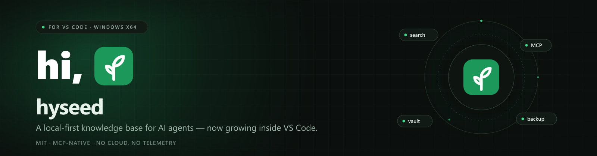

<p align="center">
  
</p>

<p align="center">
  <a href="https://marketplace.visualstudio.com/items?itemName=limccn.kbmcp-vscode"></a>
  <a href="https://open-vsx.org/extension/limccn/kbmcp-vscode"></a>
  
  
  
  
</p>

<p align="center">
  <a href="https://github.com/limccn/kb-mcp-vscode/blob/main/README.md">English</a> · <a href="https://github.com/limccn/kb-mcp-vscode/blob/main/README.zh-CN.md">简体中文</a> · <strong>日本語</strong>
</p>

## hi, 🌱

ようこそ！**hyseed** は AI エージェントのためのローカルファーストなナレッジベースで、ここはその VS Code の住処です。チームの意思決定、教訓、API、ランブックをサイドバーから検索し、管理コンソールをタブで開き、Claude Code、Cursor、Cline などの MCP クライアントから同じ知識を直接参照できます。データはすべて手元のマシンに残ります。

このリポジトリには VS Code 拡張機能と[製品ポータル](portal/)が含まれます。`hyseed.exe` ランタイムは拡張機能に同梱されているため、別途インストールする必要はありません。

### できること

- **サイドバー検索** — 保管庫ごとの検索。モード、件数、フィルター、保管庫ごとの検索履歴に対応。
- **管理コンソール** — フル機能の hyseed 管理画面を Webview タブで表示。
- **MCP とスキル** — `hyseed` MCP サーバーを登録し、Claude Code／Codex／Cline 用のエージェントスキルを導入。
- **保管庫（vault）** — グローバルな保管庫と、ワークスペース単位の固定。
- **バックアップ** — `⋯` メニューから全ドキュメントを Markdown で書き出し／取り込み。
- **すぐ使える** — `hyseed.exe` を同梱。別途インストール不要。

## インストール

### VS Code Marketplace（推奨）

[Marketplace の hyseed](https://marketplace.visualstudio.com/items?itemName=limccn.kbmcp-vscode) を開くか、ターミナルから実行します：

```bash
code --install-extension limccn.kbmcp-vscode
```

インストール後にウィンドウを再読み込みしてください。コマンドは `hyseed:` にあります。

### Open VSX

VSCodium など VS Code 互換のエディターでは、[Open VSX の hyseed](https://open-vsx.org/extension/limccn/kbmcp-vscode) を使います：

```bash
codium --install-extension limccn.kbmcp-vscode
```

### オフライン VSIX

[Releases](https://github.com/limccn/kb-mcp-vscode/releases) から最新の `kbmcp-vscode-win32-x64-<version>.vsix` をダウンロードし、次を実行します：

```bash
code --install-extension kbmcp-vscode-win32-x64-<version>.vsix
```

### ソースから

```bash
npm ci
npm run package
```

`resources/hyseed.exe` と `resources/doc-convert.exe` はリポジトリが大きくなるため git に含まれません。[GitHub Release](https://github.com/limccn/kb-mcp-vscode/releases) からダウンロードして `resources/` に置くか、`HYSEED_RUNTIME_EXE` と `DOC_CONVERT_EXE` で自分のコピーを指定してください。VSIX には両方同梱されているため、必要なのはソースからビルドする場合だけです。詳しくは [resources/README.md](resources/README.md) を参照してください。

## 初回起動

1. **CLI ツール**（推奨・既定でオン）— `hyseed.exe` と `doc-convert.exe` を
   `%USERPROFILE%\.local\bin` にコピーします。PATH は確認のみで変更しません。
2. **MCP とスキル**（任意）— AI ツール用の MCP サーバーとエージェントスキルを登録します。
3. **データフォルダー** — 既定（`%USERPROFILE%\.local\share\hyseed`）を受け入れるか、別の場所を
   選択します。`default` 保管庫が作成されます。

初回インストールまたはメジャー／マイナー更新後にガイドが自動で開きます。
`hyseed: Setup guide` で再表示でき、管理コンソールの **Doctor** からも開けます。

## 重要な環境変数

hyseed が読む環境変数はわずかです。両方がある場合は VS Code 設定が優先され、環境変数はターミナル、他のエディター、MCP クライアント向けの逃げ道になります。

| 変数 | 役割 | 既定値 / 優先順位 |
|---|---|---|
| `KB_MCP_HOME` | データルート：保管庫、ドキュメント、SQLite インデックス。拡張機能はすべての `hyseed` 子プロセスにこれを渡します。 | `kbMcp.dataRoot` → `KB_MCP_HOME` → ランタイム設定の `data_dir` → `%USERPROFILE%\.local\share\hyseed` |
| `KB_MCP_VAULT` | `hyseed` CLI と MCP サーバーの既定の保管庫。ワークスペースを固定すると `.mcp.json` にもこのキーが書き込まれます。 | `kbMcp.projectVault` → `KB_MCP_VAULT` → ランタイムの現在の保管庫 |
| `KB_MCP_CONFIG` | ランタイム YAML 設定へのパス。拡張機能はトップレベルの `data_dir:` 行だけを読みます。 | `%USERPROFILE%\.config\hyseed\config.yaml` |
| `KB_MCP_HTTP_TOKEN` | HTTP MCP トランスポート用の Bearer トークン。`hyseed serve --transport http` で必要で、`kbMcp.mcpHost` がループバック以外なら必須です。 | コマンドパレットの **Serve (HTTP)** は `%USERPROFILE%\.hyseed-http-token` を読みます。値がターミナルに出ることはありません。 |
| `KB_INGEST_CONVERTER` | `ingest` が使う `doc-convert.exe` のパス。 | `kbMcp.converterPath` → `KB_INGEST_CONVERTER` → `hyseed.exe` の隣 → ワークスペースの `ingestion-rt/` → 同梱コピー |
| `KB_MCP_VSCODE_LOG` | 省略可能なファイルパス。拡張機能の出力チャンネルをファイルにも書き出します。 | 未設定（出力チャンネルのみ） |
| `PATH` | `hyseed` CLI の検索先。**Install CLI tools** は実行ファイルを `%USERPROFILE%\.local\bin` にコピーし、PATH にあるかどうかを報告します。 | PATH は自動変更しません |

パッケージ作成者向けに、ランタイムの場所を指定するビルド時の変数が 2 つあります：

| 変数 | 役割 | 既定値 |
|---|---|---|
| `HYSEED_RUNTIME_EXE` | `prepare-runtime` が使う `hyseed.exe` のパス | `resources/hyseed.exe`（または monorepo の兄弟ディレクトリのビルド成果物） |
| `DOC_CONVERT_EXE` | `prepare-runtime` が使う `doc-convert.exe` のパス | `resources/doc-convert.exe`（または monorepo の兄弟ディレクトリのビルド成果物） |

> **ヒント：** もっとも重要なのは `KB_MCP_HOME` です。ナレッジベース全体を移すならこの変数を新しいフォルダーに向け、拡張機能だけ別のフォルダーを使いたいなら `kbMcp.dataRoot` を設定してください。

## VS Code 設定

| 設定 | 既定値 | 説明 |
|---|---|---|
| `kbMcp.runtimePath` | `""` | `hyseed.exe` を指定。空 = 自動検出 |
| `kbMcp.adminPort` | `51888` | 管理ポート。使用中なら次の空きポート |
| `kbMcp.adminHost` | `127.0.0.1` | バインド先。非ループバックは認証なしで公開されます |
| `kbMcp.mcpHost` | `127.0.0.1` | MCP HTTP のバインド先。非ループバックはトークンとファイアウォール設定が必要 |
| `kbMcp.dataRoot` | `""` | データフォルダーを指定。空 = 既定 |
| `kbMcp.projectVault` | `""` | ワークスペースで固定する保管庫 |
| `kbMcp.converterPath` | `""` | `doc-convert.exe` を指定。空 = 自動検出 |

## 0.1.x からのアップグレード

0.2.0 では旧名称・旧保存先を廃止しました。起動時、データフォルダーが空の場合に 0.1.x の
データを確認し、選択するまで書き込みません。

- **移行** — 旧データを新しいフォルダーへ移動します。
- **既存を使う** — 新しいフォルダーを維持し、旧フォルダーはそのまま残します。
- **後で** — `hyseed: Setup data folder` を実行するまで起動を保留します。

新旧両方にデータがある場合は一方だけを選び、マージはしません。ダウングレードはできないため、
重要なドキュメントは先にバックアップしてください（`⋯` → **Export backup**）。

`~/.config/kb-mcp`、旧 HTTP トークンファイル、`kb-mcp.exe` は読み込まれません。

## サイドバー

保管庫は専用の行に表示されます。上部バーには新規作成、設定、更新、管理、`⋯` メニュー
（管理サービス、MCP 状態、アップロード、バックアップの書き出し／取り込み、`/git`、メンテナンス）
があります。検索結果は VS Code のブラウザーで開き、右クリックでコピーできます。

## データとバックアップ

ドキュメントは既定で `%USERPROFILE%\.local\share\hyseed` に保存されます。拡張機能を更新しても
このフォルダーは変更されません。`⋯` → **Export backup** で Markdown として持ち出し、
**Import backup** で復元できます。

## コマンド

すべてコマンドパレットの `hyseed:` にあります。完全な一覧は以下です。必要なときだけ展開してください。

<details>
<summary><strong>すべてのコマンド</strong></summary>

| ID | 用途 |
|---|---|
| `kbmcp.openAdmin` | 管理コンソールを開く |
| `kbmcp.startServer` | 管理サーバーを起動 |
| `kbmcp.stopServer` | 拡張機能が起動したサーバーを停止 |
| `kbmcp.restartServer` | サーバーを再起動 |
| `kbmcp.openInBrowser` | ブラウザーで管理コンソールを開く |
| `kbmcp.showRuntimeInfo` | 使用中の実行ファイルを表示 |
| `kbmcp.showLogs` | 出力チャンネルを開く |
| `kbmcp.showMcpStatus` | MCP の登録状態と保管庫を表示 |
| `kbmcp.installAgentSkills` | エージェントスキルを導入 |
| `kbmcp.installCliTools` | `hyseed.exe` / `doc-convert.exe` を導入 |
| `kbmcp.removeAgentSkills` | エージェントスキルを削除 |
| `kbmcp.showSkillsState` | スキルの導入状態を表示 |
| `kbmcp.createVault` | 保管庫を作成 |
| `kbmcp.switchVault` | 既定の保管庫を切り替え |
| `kbmcp.clearProjectVault` | ワークスペースの固定を解除 |
| `kbmcp.listVaults` | 保管庫一覧を表示 |
| `kbmcp.resumeMigration` | データフォルダーの選択を再開 |
| `kbmcp.openSetupGuide` | セットアップガイドを開く |
| `kbmcp.cli.search` | `hyseed search` を実行 |
| `kbmcp.cli.get` | `hyseed get` を実行 |
| `kbmcp.cli.list` | `hyseed list` を実行 |
| `kbmcp.cli.add` | `hyseed add` を実行 |
| `kbmcp.cli.ingest` | `hyseed ingest` を実行 |
| `kbmcp.cli.import` | `hyseed import` を実行 |
| `kbmcp.cli.export` | `hyseed export` を実行 |
| `kbmcp.cli.doctor` | `hyseed doctor` を実行 |
| `kbmcp.cli.stats` | `hyseed stats` を実行 |
| `kbmcp.cli.reindex` | `hyseed reindex` を実行 |
| `kbmcp.cli.diff-check` | `hyseed diff-check` を実行 |
| `kbmcp.cli.history` | `hyseed history` を実行 |
| `kbmcp.cli.vaultList` | `hyseed vault list` を実行 |
| `kbmcp.cli.vaultCreate` | `hyseed vault create` を実行 |
| `kbmcp.cli.vaultSwitch` | `hyseed vault switch` を実行 |
| `kbmcp.cli.vaultStatus` | `hyseed vault status` を実行 |
| `kbmcp.cli.skillsList` | `hyseed skills list` を実行 |
| `kbmcp.cli.skillsShow` | `hyseed skills show` を実行 |
| `kbmcp.cli.skillsAdd` | `hyseed skills add` を実行 |
| `kbmcp.cli.skillsRemove` | `hyseed skills remove` を実行 |
| `kbmcp.cli.serveHttp` | `hyseed serve`（HTTP）を実行 |

</details>

CLI コマンドは専用の `hyseed` ターミナルで実行します。`"`、`%`、`!`、改行を含む値は
安全のため拒否されます。そのような場合はご自身のターミナルで実行してください。

## トラブルシューティング

| 症状 | 対処 |
|---|---|
| ポート 51888 が使用中 | 次の空きポートを自動で使用します |
| `hyseed.exe` が見つからない | `hyseed: Show runtime info` を確認、または `kbMcp.runtimePath` を設定 |
| 取り込みで変換ツールが見つからない | `kbMcp.converterPath` に `doc-convert.exe` を設定し、サーバーを再起動 |
| 停止後もポートが開いたまま | エラーに表示される PID を `taskkill /PID <pid> /T /F` で終了 |
| 管理タブが空 | サーバーを起動し、`hyseed: Show logs` を確認 |

## プライバシー

管理コンソールと MCP サーバーは既定でループバックにのみバインドされます。管理コンソールには
認証がないため、信頼できるネットワークでのみ公開してください。認証情報はユーザープロファイル
に保存され、拡張機能には保存されません。エージェント側の設定ファイルは `hyseed` CLI だけが
バックアップ付きで書き込みます。

## リポジトリ構成

| パス | 内容 |
|---|---|
| `src/` | TypeScript 拡張機能 |
| `resources/` | アイコン。ランタイムのバイナリはコミットされません（[resources/README.md](resources/README.md) を参照） |
| `scripts/` | ビルド、パッケージング、統合ドリルのスクリプト |
| `portal/` | hyseed 製品サイト（Next.js の静的エクスポート） |
| `docs/` | 公開メモ |
| `assets/` | バナーとソーシャルプレビューの画像 |

## 開発

```bash
npm ci
npm run build        # dist/extension.js
npm run typecheck
npm test
npm run check:docs
npm run package      # win32-x64 VSIX をビルド
```

製品ポータルの手順は `portal/README.md` にあります。

## コントリビュート

Issue と Pull Request を歓迎します。誤字修正より大きな変更は、まず Issue で方向性を揃えてください。変更は焦点を絞り、PR を送る前に `npm run typecheck`、`npm test`、`npm run check:docs` を実行してください。

## ライセンス

MIT — [LICENSE](LICENSE) を参照。

## 謝辞

この小さな苗を育ててくれた [@HelloTomBruce](https://github.com/HelloTomBruce) さんの励ましとサポートに感謝します。🌱

<p align="center"><sub>hi, 🌱 — 立ち寄ってくれてありがとう。</sub></p>
