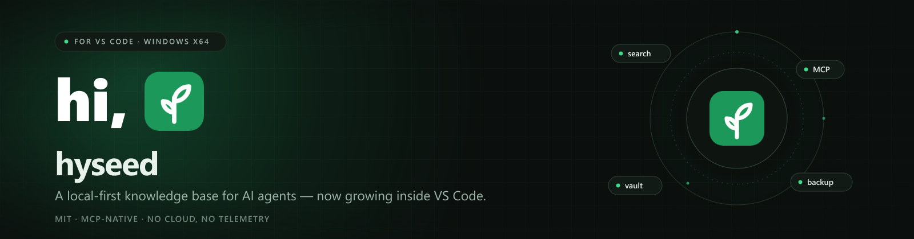

<p align="center">
  
</p>

<p align="center">
  <a href="https://marketplace.visualstudio.com/items?itemName=limccn.kbmcp-vscode"></a>
  <a href="https://open-vsx.org/extension/limccn/kbmcp-vscode"></a>
  
  
  
  
</p>

<p align="center">
  <strong>English</strong> · <a href="https://github.com/limccn/kb-mcp-vscode/blob/main/README.zh-CN.md">简体中文</a> · <a href="https://github.com/limccn/kb-mcp-vscode/blob/main/README.ja.md">日本語</a>
</p>

## hi, 🌱

Welcome! **hyseed** is a local-first knowledge base for AI agents — and this is its home inside VS Code. Search your team's decisions, lessons, APIs, and runbooks from the sidebar, open the admin console in a tab, or let Claude Code, Cursor, Cline, and other MCP clients query the same knowledge directly. Everything stays on your machine.

This repository contains the VS Code extension and the [product portal](portal/). The `hyseed.exe` runtime is bundled into the extension, so there is nothing else to install.

### What you get

- **Sidebar search** — vault-aware search with mode, result count, filters, and per-vault history.
- **Admin console** — the full hyseed admin UI in a Webview tab.
- **MCP & skills** — register the `hyseed` MCP server and install agent skills for Claude Code, Codex, or Cline.
- **Vaults** — global vaults plus a per-workspace pin.
- **Backup** — export/import all documents as Markdown from the `⋯` menu.
- **Batteries included** — a `hyseed.exe` is bundled; no separate install is required.

## Install

### VS Code Marketplace (recommended)

Open [hyseed on the Marketplace](https://marketplace.visualstudio.com/items?itemName=limccn.kbmcp-vscode), or install from a terminal:

```bash
code --install-extension limccn.kbmcp-vscode
```

Reload the window afterwards. Commands appear under `hyseed:`.

### Open VSX

For VSCodium and other VS Code-compatible editors, use [hyseed on Open VSX](https://open-vsx.org/extension/limccn/kbmcp-vscode):

```bash
codium --install-extension limccn.kbmcp-vscode
```

### Offline VSIX

Download the latest `kbmcp-vscode-win32-x64-<version>.vsix` from [Releases](https://github.com/limccn/kb-mcp-vscode/releases), then:

```bash
code --install-extension kbmcp-vscode-win32-x64-<version>.vsix
```

### From source

```bash
npm ci
npm run package
```

`resources/hyseed.exe` and `resources/doc-convert.exe` are not stored in git because they make the repository heavy. Download them from the [GitHub release](https://github.com/limccn/kb-mcp-vscode/releases) into `resources/`, or point `HYSEED_RUNTIME_EXE` and `DOC_CONVERT_EXE` at your own copies. The VSIX already bundles both, so this is only needed for source builds. See [resources/README.md](resources/README.md).

## First run

1. **CLI tools** (recommended, on by default) — copies `hyseed.exe` and `doc-convert.exe` to `%USERPROFILE%\.local\bin`. PATH is reported, never changed.
2. **MCP & skills** (optional) — registers the MCP server and agent skills for your AI tools.
3. **Data folder** — accept the default (`%USERPROFILE%\.local\share\hyseed`) or choose another. A `default` vault is created.

The guide opens automatically after a first install or a major/minor upgrade. Reopen it with `hyseed: Setup guide`, or from **Doctor** in the admin console.

## Important environment variables

hyseed reads a small set of environment variables. VS Code settings win where both exist; the variables are the escape hatch for terminals, other editors, and MCP clients.

| Variable | What it does | Default / precedence |
|---|---|---|
| `KB_MCP_HOME` | Data root: vaults, documents, and the SQLite index. The extension passes it to every `hyseed` child process. | `kbMcp.dataRoot` → `KB_MCP_HOME` → `data_dir` in the runtime config → `%USERPROFILE%\.local\share\hyseed` |
| `KB_MCP_VAULT` | Default vault for the `hyseed` CLI and MCP server. Pinning a workspace also writes this key into `.mcp.json`. | `kbMcp.projectVault` → `KB_MCP_VAULT` → the runtime's current vault |
| `KB_MCP_CONFIG` | Path to the runtime YAML config. The extension reads only its top-level `data_dir:` line. | `%USERPROFILE%\.config\hyseed\config.yaml` |
| `KB_MCP_HTTP_TOKEN` | Bearer token for the HTTP MCP transport. Required by `hyseed serve --transport http`, and mandatory when `kbMcp.mcpHost` is not loopback. | The palette's **Serve (HTTP)** reads `%USERPROFILE%\.hyseed-http-token`; the value never appears in the terminal. |
| `KB_INGEST_CONVERTER` | Path to `doc-convert.exe` used by `ingest`. | `kbMcp.converterPath` → `KB_INGEST_CONVERTER` → next to `hyseed.exe` → `ingestion-rt/` in the workspace → the bundled copy |
| `KB_MCP_VSCODE_LOG` | Optional file path. Mirrors the extension's output channel to a file for bug reports. | Unset (output channel only) |
| `PATH` | Where the `hyseed` CLI is found. **Install CLI tools** copies the binaries to `%USERPROFILE%\.local\bin` and reports whether it is on PATH. | PATH is never edited automatically |

For packagers, two build-time variables point `npm run package` at the runtime binaries:

| Variable | What it does | Default |
|---|---|---|
| `HYSEED_RUNTIME_EXE` | Path to `hyseed.exe` for `prepare-runtime` | `resources/hyseed.exe` (or the monorepo sibling build) |
| `DOC_CONVERT_EXE` | Path to `doc-convert.exe` for `prepare-runtime` | `resources/doc-convert.exe` (or the monorepo sibling build) |

> **Tip:** `KB_MCP_HOME` is the one that matters most. Point it at a folder to move the whole knowledge base, or set `kbMcp.dataRoot` if you only want the extension to use a different folder.

## VS Code settings

| Setting | Default | Meaning |
|---|---|---|
| `kbMcp.runtimePath` | `""` | Explicit `hyseed.exe`; empty = auto-detect |
| `kbMcp.adminPort` | `51888` | Preferred admin port; the next free port is used |
| `kbMcp.adminHost` | `127.0.0.1` | Bind address; non-loopback exposes the console (no authentication) |
| `kbMcp.mcpHost` | `127.0.0.1` | MCP HTTP bind address; non-loopback needs a token and firewall rule |
| `kbMcp.dataRoot` | `""` | Explicit data folder; empty = default |
| `kbMcp.projectVault` | `""` | Workspace-pinned vault |
| `kbMcp.converterPath` | `""` | Explicit `doc-convert.exe`; empty = auto-detect |

## Upgrading from 0.1.x

0.2.0 retires the old names and locations. On activation, an empty data folder is checked for data left by 0.1.x. Nothing is written until you choose:

- **Migrate** — move the old data into the new folder.
- **Use existing** — keep the new folder and leave the old one in place.
- **Not now** — hold startup until `hyseed: Setup data folder`.

If both folders contain data, you pick one; nothing is merged. There is no downgrade path, so back up important documents first (`⋯` → **Export backup**).

`~/.config/kb-mcp`, the old HTTP token file, and `kb-mcp.exe` are no longer read or launched.

## Sidebar

The vault has its own row; the top bar holds create, settings, refresh, admin, and the `⋯` menu (admin service, MCP status, uploads, backup export/import, `/git`, maintenance). Results open in VS Code's browser and offer copy/link actions on right-click.

## Data and backup

Documents live in `%USERPROFILE%\.local\share\hyseed` by default. Keep that folder to keep your knowledge base; updating the extension does not touch it. Use `⋯` → **Export backup** for a portable Markdown copy and **Import backup** to restore one.

## Commands

All commands are in the Command Palette under `hyseed:`. The full list is below — collapse it when you just want the highlights.

<details>
<summary><strong>All commands</strong></summary>

| ID | Purpose |
|---|---|
| `kbmcp.openAdmin` | Open the admin console tab |
| `kbmcp.startServer` | Start the admin server |
| `kbmcp.stopServer` | Stop the extension-owned server |
| `kbmcp.restartServer` | Restart the server |
| `kbmcp.openInBrowser` | Open the console in a browser |
| `kbmcp.showRuntimeInfo` | Show the resolved executable |
| `kbmcp.showLogs` | Open the output channel |
| `kbmcp.showMcpStatus` | Show MCP registration and vault |
| `kbmcp.installAgentSkills` | Install agent skills |
| `kbmcp.installCliTools` | Install `hyseed.exe` / `doc-convert.exe` |
| `kbmcp.removeAgentSkills` | Remove agent skills |
| `kbmcp.showSkillsState` | Show skills install state |
| `kbmcp.createVault` | Create a vault |
| `kbmcp.switchVault` | Switch the default vault |
| `kbmcp.clearProjectVault` | Clear the workspace pin |
| `kbmcp.listVaults` | List vaults |
| `kbmcp.resumeMigration` | Resume the data-folder decision |
| `kbmcp.openSetupGuide` | Open the setup guide |
| `kbmcp.cli.search` | Run `hyseed search` |
| `kbmcp.cli.get` | Run `hyseed get` |
| `kbmcp.cli.list` | Run `hyseed list` |
| `kbmcp.cli.add` | Run `hyseed add` |
| `kbmcp.cli.ingest` | Run `hyseed ingest` |
| `kbmcp.cli.import` | Run `hyseed import` |
| `kbmcp.cli.export` | Run `hyseed export` |
| `kbmcp.cli.doctor` | Run `hyseed doctor` |
| `kbmcp.cli.stats` | Run `hyseed stats` |
| `kbmcp.cli.reindex` | Run `hyseed reindex` |
| `kbmcp.cli.diff-check` | Run `hyseed diff-check` |
| `kbmcp.cli.history` | Run `hyseed history` |
| `kbmcp.cli.vaultList` | Run `hyseed vault list` |
| `kbmcp.cli.vaultCreate` | Run `hyseed vault create` |
| `kbmcp.cli.vaultSwitch` | Run `hyseed vault switch` |
| `kbmcp.cli.vaultStatus` | Run `hyseed vault status` |
| `kbmcp.cli.skillsList` | Run `hyseed skills list` |
| `kbmcp.cli.skillsShow` | Run `hyseed skills show` |
| `kbmcp.cli.skillsAdd` | Run `hyseed skills add` |
| `kbmcp.cli.skillsRemove` | Run `hyseed skills remove` |
| `kbmcp.cli.serveHttp` | Run `hyseed serve` (HTTP) |

</details>

CLI commands open in a dedicated `hyseed` terminal. Values containing `"`, `%`, `!`, or a newline are refused for safety; run those in your own terminal.

## Troubleshooting

| Symptom | Fix |
|---|---|
| Port 51888 busy | The next free port is used automatically |
| `hyseed.exe` not found | Check `hyseed: Show runtime info`, or set `kbMcp.runtimePath` |
| Ingest cannot find a converter | Set `kbMcp.converterPath` to `doc-convert.exe` and restart the server |
| Stop leaves the port open | The error names the PID; end it with `taskkill /PID <pid> /T /F` |
| Admin tab is blank | Start the server and check `hyseed: Show logs` |

## Privacy

The admin console and MCP server bind to loopback by default. The admin console has no authentication; only expose it on a trusted network. Credentials are stored in your user profile (never in this extension), and agent host files are written only by the `hyseed` CLI with a backup.

## Repository layout

| Path | What lives there |
|---|---|
| `src/` | The TypeScript extension |
| `resources/` | Icons; runtime binaries are not committed (see [resources/README.md](resources/README.md)) |
| `scripts/` | Build, packaging, and integration-drill helpers |
| `portal/` | The hyseed product site (Next.js static export) |
| `docs/` | Publishing notes |
| `assets/` | Banner and social-preview artwork |

## Development

```bash
npm ci
npm run build        # dist/extension.js
npm run typecheck
npm test
npm run check:docs
npm run package      # builds the win32-x64 VSIX
```

The product portal has its own instructions in `portal/README.md`.

## Contributing

Issues and pull requests are welcome. For anything larger than a typo, open an issue first so we can agree on the shape. Keep changes focused, and run `npm run typecheck`, `npm test`, and `npm run check:docs` before sending a PR.

## License

MIT — see [LICENSE](LICENSE).

## Thanks

Thanks to [@HelloTomBruce](https://github.com/HelloTomBruce) for the encouragement, ideas, and good energy that helped this little seedling grow. 🌱

<p align="center"><sub>hi, 🌱 — thanks for stopping by.</sub></p>
