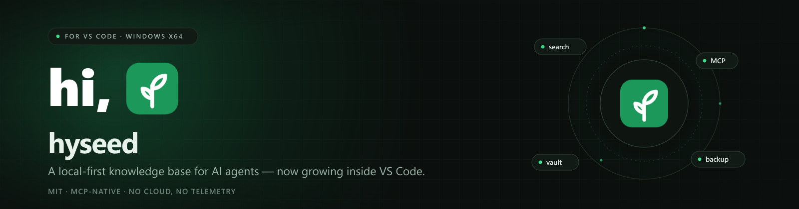

<p align="center">
  
</p>

<p align="center">
  <a href="https://marketplace.visualstudio.com/items?itemName=limccn.kbmcp-vscode"></a>
  <a href="https://open-vsx.org/extension/limccn/kbmcp-vscode"></a>
  
  
  
  
</p>

<p align="center">
  <a href="https://github.com/limccn/kb-mcp-vscode/blob/main/README.md">English</a> · <strong>简体中文</strong> · <a href="https://github.com/limccn/kb-mcp-vscode/blob/main/README.ja.md">日本語</a>
</p>

## hi, 🌱

欢迎！**hyseed** 是为 AI 代理准备的本地优先知识库，而这里就是它在 VS Code 里的家。你可以从侧栏检索团队的决策、经验、API 与运维手册，在标签页里打开管理台，也可以让 Claude Code、Cursor、Cline 等 MCP 客户端直接查询同一份知识。所有数据都留在你的机器上。

本仓库包含 VS Code 扩展与[产品门户](portal/)。`hyseed.exe` 运行时已随扩展打包，不需要另行安装。

### 你可以得到什么

- **侧栏检索** — 按 vault 检索，支持模式、结果数、过滤条件与每个 vault 的检索历史。
- **管理台** — 在 Webview 标签页中打开完整的 hyseed 管理界面。
- **MCP 与技能** — 注册 `hyseed` MCP 服务器，为 Claude Code、Codex、Cline 安装代理技能。
- **Vault** — 全局 vault，并可为当前工作区固定一个。
- **备份** — 在 `⋯` 菜单中把全部文档导出/导入为 Markdown。
- **开箱即用** — 扩展自带 `hyseed.exe`，无需单独安装。

## 安装

### VS Code Marketplace（推荐）

打开 [Marketplace 上的 hyseed](https://marketplace.visualstudio.com/items?itemName=limccn.kbmcp-vscode)，或在终端执行：

```bash
code --install-extension limccn.kbmcp-vscode
```

安装后重新加载窗口。命令位于 `hyseed:` 前缀下。

### Open VSX

VSCodium 及其他兼容 VS Code 的编辑器可以使用 [Open VSX 上的 hyseed](https://open-vsx.org/extension/limccn/kbmcp-vscode)：

```bash
codium --install-extension limccn.kbmcp-vscode
```

### 离线 VSIX

从 [Releases](https://github.com/limccn/kb-mcp-vscode/releases) 下载最新的 `kbmcp-vscode-win32-x64-<version>.vsix`，然后：

```bash
code --install-extension kbmcp-vscode-win32-x64-<version>.vsix
```

### 从源码构建

```bash
npm ci
npm run package
```

`resources/hyseed.exe` 与 `resources/doc-convert.exe` 不进入 git（否则仓库会非常大）。可从 [GitHub Release](https://github.com/limccn/kb-mcp-vscode/releases) 下载后放进 `resources/`，或用 `HYSEED_RUNTIME_EXE`、`DOC_CONVERT_EXE` 指向你自己的副本。VSIX 已内置这两个文件，只有从源码构建时才需要。详见 [resources/README.md](resources/README.md)。

## 首次使用

1. **CLI 工具**（推荐，默认勾选）— 把 `hyseed.exe` 与 `doc-convert.exe` 复制到
   `%USERPROFILE%\.local\bin`。只报告 PATH 状态，不修改 PATH。
2. **MCP 与技能**（可选）— 为你的 AI 工具注册 MCP 服务器与代理技能。
3. **数据目录** — 使用默认目录（`%USERPROFILE%\.local\share\hyseed`）或另选；会创建
   `default` vault。

首次安装或大版本升级后，向导会自动打开。可用 `hyseed: Setup guide` 重开，或在管理台的
**Doctor** 中打开。

## 重要环境变量

hyseed 只读取少量环境变量。两者同时存在时，VS Code 设置优先；环境变量则用于终端、其他编辑器与 MCP 客户端。

| 变量 | 作用 | 默认值 / 优先级 |
|---|---|---|
| `KB_MCP_HOME` | 数据根目录：vault、文档与 SQLite 索引。扩展会把它传给每个 `hyseed` 子进程。 | `kbMcp.dataRoot` → `KB_MCP_HOME` → 运行时配置里的 `data_dir` → `%USERPROFILE%\.local\share\hyseed` |
| `KB_MCP_VAULT` | `hyseed` CLI 与 MCP 服务的默认 vault。固定工作区时也会把该键写入 `.mcp.json`。 | `kbMcp.projectVault` → `KB_MCP_VAULT` → 运行时的当前 vault |
| `KB_MCP_CONFIG` | 运行时 YAML 配置路径。扩展只读取其中的顶层 `data_dir:` 行。 | `%USERPROFILE%\.config\hyseed\config.yaml` |
| `KB_MCP_HTTP_TOKEN` | HTTP MCP 传输的 Bearer token。`hyseed serve --transport http` 需要它；`kbMcp.mcpHost` 非回环时必须设置。 | 命令面板的 **Serve (HTTP)** 会读取 `%USERPROFILE%\.hyseed-http-token`；值不会出现在终端里。 |
| `KB_INGEST_CONVERTER` | `ingest` 使用的 `doc-convert.exe` 路径。 | `kbMcp.converterPath` → `KB_INGEST_CONVERTER` → `hyseed.exe` 同级 → 工作区 `ingestion-rt/` → 内置副本 |
| `KB_MCP_VSCODE_LOG` | 可选文件路径。把扩展输出面板镜像到文件，便于反馈问题。 | 不设置（仅输出面板） |
| `PATH` | `hyseed` CLI 的查找位置。**Install CLI tools** 会把可执行文件复制到 `%USERPROFILE%\.local\bin`，并报告该目录是否在 PATH 中。 | 不自动修改 PATH |

如果你要自己打包，还有两个构建期变量用来定位运行时：

| 变量 | 作用 | 默认值 |
|---|---|---|
| `HYSEED_RUNTIME_EXE` | `prepare-runtime` 使用的 `hyseed.exe` 路径 | `resources/hyseed.exe`（或 monorepo 兄弟目录的构建产物） |
| `DOC_CONVERT_EXE` | `prepare-runtime` 使用的 `doc-convert.exe` 路径 | `resources/doc-convert.exe`（或 monorepo 兄弟目录的构建产物） |

> **提示：** 最常用的是 `KB_MCP_HOME`。想整体搬走知识库就把它指向新目录；只想改扩展的行为就设 `kbMcp.dataRoot`。

## VS Code 设置

| 设置 | 默认值 | 说明 |
|---|---|---|
| `kbMcp.runtimePath` | `""` | 指定 `hyseed.exe`；留空 = 自动检测 |
| `kbMcp.adminPort` | `51888` | 首选管理端口；被占用时顺延 |
| `kbMcp.adminHost` | `127.0.0.1` | 绑定地址；非回环会暴露无鉴权的管理台 |
| `kbMcp.mcpHost` | `127.0.0.1` | MCP HTTP 绑定地址；非回环需令牌与防火墙规则 |
| `kbMcp.dataRoot` | `""` | 指定数据目录；留空 = 默认目录 |
| `kbMcp.projectVault` | `""` | 工作区固定的 vault |
| `kbMcp.converterPath` | `""` | 指定 `doc-convert.exe`；留空 = 自动检测 |

## 从 0.1.x 升级

0.2.0 退役了旧名称与旧位置。激活时，若数据目录为空，扩展会检查 0.1.x 留下的数据；在你
做出选择前不会写入任何内容：

- **迁移** — 把旧数据移动到新目录。
- **使用现有** — 保留新目录，旧目录原样不动。
- **稍后** — 启动挂起，直到执行 `hyseed: Setup data folder`。

若新旧目录都有数据，只能二选一，不会合并。没有降级路径，重要文档请先备份
（`⋯` → **Export backup**）。

`~/.config/kb-mcp`、旧 HTTP token 文件与 `kb-mcp.exe` 不再被读取或启动。

## 侧栏

Vault 独占一行；顶栏包含新建、设置、刷新、管理与 `⋯` 菜单（管理服务、MCP 状态、上传、
备份导出/导入、`/git`、维护）。结果在 VS Code 浏览器中打开，右键可复制或复制链接。

## 数据与备份

文档默认位于 `%USERPROFILE%\.local\share\hyseed`。更新扩展不会影响该目录。用 `⋯` →
**Export backup** 导出可移植的 Markdown 副本，用 **Import backup** 恢复。

## 命令

所有命令均在命令面板的 `hyseed:` 前缀下。完整列表如下，需要时展开即可。

<details>
<summary><strong>全部命令</strong></summary>

| ID | 用途 |
|---|---|
| `kbmcp.openAdmin` | 打开管理台标签页 |
| `kbmcp.startServer` | 启动管理服务 |
| `kbmcp.stopServer` | 停止扩展管理的服务 |
| `kbmcp.restartServer` | 重启服务 |
| `kbmcp.openInBrowser` | 在浏览器中打开管理台 |
| `kbmcp.showRuntimeInfo` | 显示解析到的可执行文件 |
| `kbmcp.showLogs` | 打开输出面板 |
| `kbmcp.showMcpStatus` | 显示 MCP 注册状态与 vault |
| `kbmcp.installAgentSkills` | 安装代理技能 |
| `kbmcp.installCliTools` | 安装 `hyseed.exe` / `doc-convert.exe` |
| `kbmcp.removeAgentSkills` | 移除代理技能 |
| `kbmcp.showSkillsState` | 显示技能安装状态 |
| `kbmcp.createVault` | 新建 vault |
| `kbmcp.switchVault` | 切换默认 vault |
| `kbmcp.clearProjectVault` | 清除工作区固定 |
| `kbmcp.listVaults` | 列出 vault |
| `kbmcp.resumeMigration` | 继续数据目录选择 |
| `kbmcp.openSetupGuide` | 打开设置向导 |
| `kbmcp.cli.search` | 运行 `hyseed search` |
| `kbmcp.cli.get` | 运行 `hyseed get` |
| `kbmcp.cli.list` | 运行 `hyseed list` |
| `kbmcp.cli.add` | 运行 `hyseed add` |
| `kbmcp.cli.ingest` | 运行 `hyseed ingest` |
| `kbmcp.cli.import` | 运行 `hyseed import` |
| `kbmcp.cli.export` | 运行 `hyseed export` |
| `kbmcp.cli.doctor` | 运行 `hyseed doctor` |
| `kbmcp.cli.stats` | 运行 `hyseed stats` |
| `kbmcp.cli.reindex` | 运行 `hyseed reindex` |
| `kbmcp.cli.diff-check` | 运行 `hyseed diff-check` |
| `kbmcp.cli.history` | 运行 `hyseed history` |
| `kbmcp.cli.vaultList` | 运行 `hyseed vault list` |
| `kbmcp.cli.vaultCreate` | 运行 `hyseed vault create` |
| `kbmcp.cli.vaultSwitch` | 运行 `hyseed vault switch` |
| `kbmcp.cli.vaultStatus` | 运行 `hyseed vault status` |
| `kbmcp.cli.skillsList` | 运行 `hyseed skills list` |
| `kbmcp.cli.skillsShow` | 运行 `hyseed skills show` |
| `kbmcp.cli.skillsAdd` | 运行 `hyseed skills add` |
| `kbmcp.cli.skillsRemove` | 运行 `hyseed skills remove` |
| `kbmcp.cli.serveHttp` | 运行 `hyseed serve`（HTTP） |

</details>

CLI 命令在专用的 `hyseed` 终端中运行。包含 `"`、`%`、`!` 或换行的值会被拒绝，请在你
自己的终端中执行。

## 常见问题

| 现象 | 处理 |
|---|---|
| 端口 51888 被占用 | 自动使用下一个空闲端口 |
| 找不到 `hyseed.exe` | 查看 `hyseed: Show runtime info`，或设置 `kbMcp.runtimePath` |
| 导入找不到转换器 | 设置 `kbMcp.converterPath` 指向 `doc-convert.exe`，然后重启服务 |
| 停止后端口仍占用 | 错误信息会给出 PID，用 `taskkill /PID <pid> /T /F` 结束 |
| 管理台空白 | 启动服务并查看 `hyseed: Show logs` |

## 隐私

管理台与 MCP 服务默认只绑定回环地址。管理台没有鉴权，只应在可信网络暴露。凭据保存在
用户目录（不在扩展内）；代理宿主的配置文件只由 `hyseed` CLI 写入，并且写入前会备份。

## 仓库结构

| 路径 | 内容 |
|---|---|
| `src/` | TypeScript 扩展 |
| `resources/` | 图标；运行时二进制不进入版本库（见 [resources/README.md](resources/README.md)） |
| `scripts/` | 构建、打包与集成演练脚本 |
| `portal/` | hyseed 产品站点（Next.js 静态导出） |
| `docs/` | 发布说明 |
| `assets/` | Banner 与社交预览图 |

## 开发

```bash
npm ci
npm run build        # dist/extension.js
npm run typecheck
npm test
npm run check:docs
npm run package      # 构建 win32-x64 VSIX
```

产品门户有自己的说明：`portal/README.md`。

## 参与贡献

欢迎提交 Issue 与 Pull Request。除错别字外，较大的改动请先开 Issue 对齐方向。保持改动
聚焦，并在提交 PR 前运行 `npm run typecheck`、`npm test` 与 `npm run check:docs`。

## 许可证

MIT — 见 [LICENSE](LICENSE)。

## 致谢

感谢 [@HelloTomBruce](https://github.com/HelloTomBruce) 的鼓励与支持，让这株小苗得以生长。🌱

<p align="center"><sub>hi, 🌱 — 感谢你路过这里。</sub></p>
